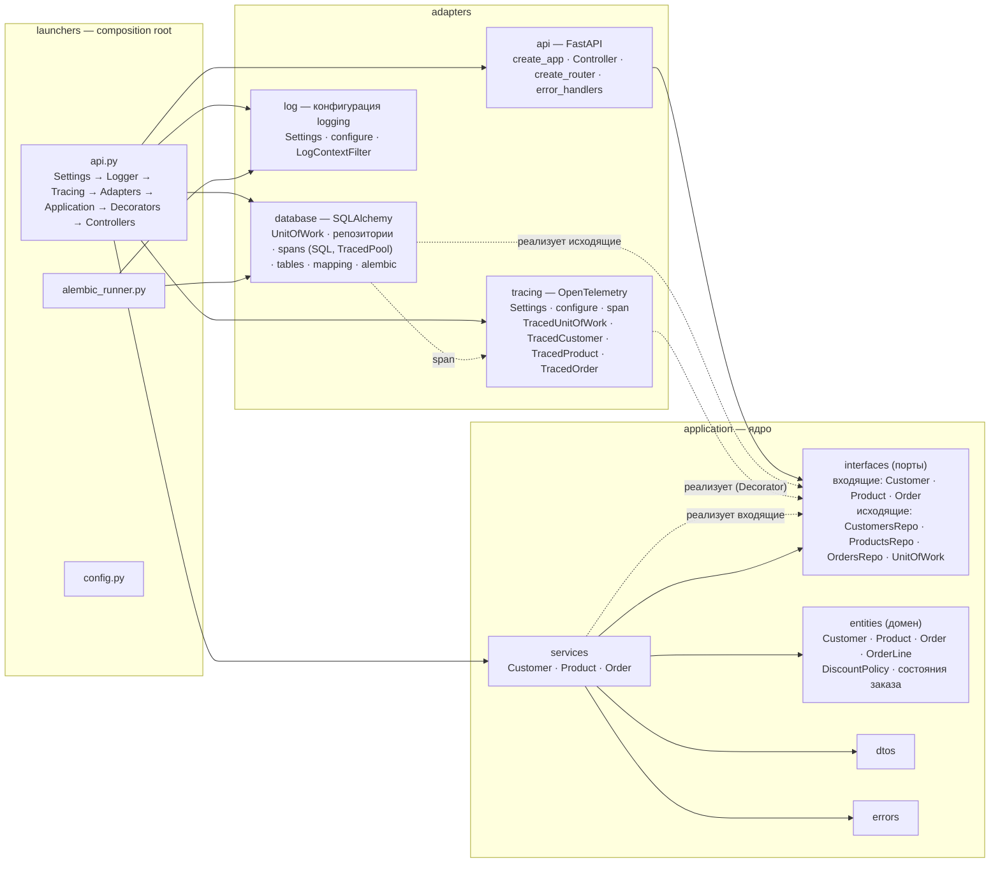
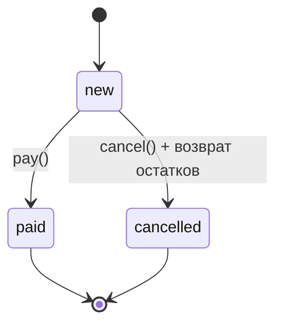

# Orders Service — учебный пример гексагональной архитектуры

Небольшой HTTP-сервис заказов (клиенты, товары, заказы), написанный как наглядный пример
**гексагональной архитектуры (Ports & Adapters)** с явным применением **SOLID**, паттернов
**GoF** и паттерна **Unit of Work**, объединяющего несколько репозиториев в одну транзакцию.

Стек: Python 3.12, FastAPI, SQLAlchemy 2 (async, asyncpg), PostgreSQL 17, Alembic, Pydantic v2,
uv, docker compose. Код, комментарии и документация — на русском, идентификаторы — на английском.
Докстринги — Google-стиль у каждого модуля, класса и функции (`Args` / `Returns` / `Raises`;
проверяет ruff `D`); пояснения к коду живут в докстрингах, а не в комментариях внутри функций
и классов.

Образцы, по которым построен проект: слои и правила слоёв — учебный репозиторий `hex_arch`;
устройство HTTP-адаптера и composition root — сервис `interactive_panels`. Действующие
правила — этот README и докстринги.

---

## Быстрый старт

Деплой устроен по образцу `hex_arch/deployment`: всё, что относится к Docker, лежит в
`deployment/` — `dockerfiles/Dockerfile` (стадии `base → dependency-installer → builder →
tests / development / production`), `docker-composes/dev/docker-compose.dev.yml` и
`docker-composes/prod/docker-compose.prod.yml`, `entrypoints/` (скрипты запуска контейнеров),
`manage/` (скрипты управления стендом), `nginx_config/`.

1. Скопируйте `.env.example` в `.env` (Windows: `copy .env.example .env`) и при необходимости
   поправьте значения. Если порт 5432 на машине занят, задайте другие хостовые порты
   (`POSTGRES_PORT=5433`, `TEST_POSTGRES_PORT=5434`): внутри compose контейнеры ходят на
   `db:5432` и `db_for_tests:5432`.
2. Перейдите в каталог деплоя: `cd deployment`.
3. Запустите стенд (на Windows — из Git Bash):
   - разработка: `bash ./manage/start.sh --dev` (compose в foreground, логи в консоли);
   - production: `bash ./manage/start.sh` (в фоне).

Остановка, перезапуск и удаление — `stop.sh`, `restart.sh`, `remove.sh` с тем же флагом
`--dev`; подробнее — `deployment/manage/README.md`.

| Контейнер | Что делает | dev | prod |
|---|---|---|---|
| `api` | `entrypoint_api.sh`: ждёт БД, применяет миграции (`entrypoint_alembic.sh`), затем запускает uvicorn (`API_WORKER_COUNT`, `LOG_LEVEL`, `ADDITIONAL_API_ARGS`) | стадия `development`; порт `APP_PORT` (8000) наружу | стадия `production` — только установленный пакет, non-root; наружу не публикуется |
| `db` | PostgreSQL 17, volume с данными | публикуется на `POSTGRES_PORT` для локальных запусков | только внутри сети |
| `db_for_tests`, `api_for_tests` | отдельная БД без volume и прогон `tests/orders_service/integration` (`entrypoint_tests.sh`, стадия `tests`; unit-тесты выполняются при сборке образа) | падение тестов не роняет стенд — смотреть лог | `api` стартует только после успешного прогона |
| `pgadmin` | веб-интерфейс к БД (`PGADMIN_EMAIL` / `PGADMIN_PASSWORD`) | порт 5050 и через nginx `/pgadmin4/` | только через nginx |
| `nginx` | reverse proxy перед API и pgAdmin (`nginx_config/`) | `NGINX_EXTERNAL_PORT` (8080) | то же; `/docs`, `/redoc`, `/openapi.json` закрыты |

Ресурсы dev-стенда: API — http://localhost:8000/api/v1 напрямую и http://localhost:8080/api/v1
через nginx; Swagger UI — http://localhost:8000/docs и http://localhost:8080/docs; pgAdmin —
http://localhost:5050/ и http://localhost:8080/pgadmin4/. В production доступен только nginx:
http://localhost:8080/api/v1 и http://localhost:8080/pgadmin4/. Изменили порты в `.env` —
обновите адреса.

Локальная разработка поверх БД dev-стенда (поднимаются только `db` и `db_for_tests`):

```bash
uv sync
docker compose --env-file .env -f deployment/docker-composes/dev/docker-compose.dev.yml up -d db db_for_tests
uv run python -m orders_service.launchers.alembic_runner upgrade head
uv run uvicorn orders_service.launchers.api:app --reload
```

Проверки (все должны быть зелёными перед отчётом о готовности):

```bash
uv run ruff check .           # линтер, в т.ч. докстринги Google-стиля (D)
uv run ruff format --check .
uv run mypy .                 # strict, включая tests/
uv run pytest                 # unit + HTTP + интеграция с Postgres
```

Интеграционные тесты БД читают `TEST_POSTGRES_*` из окружения или `.env` (на dev-стенде это
`db_for_tests` на хостовом `TEST_POSTGRES_PORT`); если переменные не заданы, они пропускаются.

---

## Сквозной сценарий

```bash
API=http://localhost:8000/api/v1
curl -s -X POST $API/customers -H 'Content-Type: application/json' \
     -d '{"name": "Иван Петров", "email": "ivan@example.com"}'          # 201, id=1
curl -s -X POST $API/products -H 'Content-Type: application/json' \
     -d '{"name": "Кружка", "price": "10.00", "stock": 5}'               # 201, id=1
curl -s -X POST $API/products -H 'Content-Type: application/json' \
     -d '{"name": "Ложка", "price": "2.50", "stock": 10}'                # 201, id=2
curl -s -X POST $API/orders -H 'Content-Type: application/json' \
     -d '{"customer_id": 1, "lines": [{"product_id": 1, "quantity": 2},
                                      {"product_id": 2, "quantity": 8}]}'
# 201: subtotal "40.00", discount "2.00" (10 единиц → объёмная скидка 5%), total "38.00";
#      остатки списаны одной транзакцией вместе с созданием заказа
curl -s -X POST $API/orders/1/pay                                        # 200, status "paid"
curl -s -X POST $API/orders/1/cancel                                     # 400, order_transition_not_allowed
curl -s -X POST $API/orders -H 'Content-Type: application/json' \
     -d '{"customer_id": 1, "lines": [{"product_id": 1, "quantity": 99}]}'
# 400, insufficient_stock: {"product_id": 1, "requested": 99, "available": 3}
curl -s "$API/orders?customer_id=1&status=paid"                          # 200, {"items": [...]}
```

Тот же сценарий удобно прогнать из Swagger UI. В PowerShell вместо `curl` используйте
`Invoke-RestMethod` или `curl.exe` с экранированием кавычек.

---

## Архитектура

Три слоя, зависимости направлены внутрь: `launchers → adapters → application`.
Ядро (`application`) не импортирует ни SQLAlchemy, ни FastAPI.



| Слой | Что внутри | Правила |
|---|---|---|
| `application/` | `entities.py` — весь домен; `services/` — сервис на сущность с набором методов; `interfaces/` — ABC портов: **входящие** (`Customer`, `Product`, `Order` — сценарии) и **исходящие** (`*Repo`, `UnitOfWork`); `dtos/` — Pydantic-модели входа/выхода и параметры поиска; `errors.py` | Между слоями передаются DTO и сущности, не `dict`/`list`. Сервисы реализуют входящие порты; контроллер и декораторы зависят от портов, а не от `services.X` |
| `adapters/api/` | `create_app`, `create_lifespan`, `error_handlers`, `v1/controller.py`, `v1/router.py`, `v1/schemas` (`*Body.to_application()`), `v1/dtos` (`*Response.from_application()`) | **Обработчики — методы класса `Controller`, порты сценариев приходят в его конструктор. FastAPI-`Depends` не используется нигде.** `Path/Query/Body` — разбор запроса, не DI. Маршруты объявляются императивно (`add_api_route`) |
| `adapters/database/` | `settings`, `database` (движок и фабрика сессий), `tables`, `mapping` (императивный маппинг dataclass-сущностей), `repositories/`, `unit_of_work`, `spans` (спаны SQL и `TracedPool`), `alembic/`, `migrations/` | Реализации портов носят имена портов и различаются модулем: `interfaces.OrdersRepo` / `database.repositories.OrdersRepo`. `UnitOfWork` и `Database` о трассировке не знают: класс пула и слушатели SQL задаёт composition root |
| `adapters/log/` | `settings` (`LOG_LEVEL`, `LOG_FORMAT`), `config` (`configure`; сборка `dictConfig` — приватная), `context` (`LogContextFilter`: `trace_id`, `span_id`) | Инфраструктура без порта: любой слой пишет через `logging.getLogger(__name__)`, хендлеры и формат задаются здесь, применяет composition root; зависимостей на другие адаптеры нет |
| `adapters/tracing/` | `settings` (`TRACING_EXPORTER`, endpoint, имя сервиса), `config` (`configure`, `shutdown`; сборщики ресурса, сэмплера, процессора и провайдера — приватные), `spans` (контекстный менеджер `span` с политикой исхода), `unit_of_work` (`TracedUnitOfWork`), `services` (`TracedCustomer`, `TracedProduct`, `TracedOrder`) | Конфигурация SDK плюс декораторы над портами ядра (GoF Decorator): спаны сценариев и единицы работы добавляются без правки сервисов и адаптера БД; `database` импортирует `tracing.span` как библиотеку, обратных импортов нет; ядро о трассировке не знает |
| `launchers/` | `api.py` — composition root HTTP-сервиса; `alembic_runner.py` — миграции; `config.py` — настройки уровня приложения | Граф собирается вручную в классах-неймспейсах при импорте модуля; все адаптеры и сервисы — синглтоны процесса |

---

## Путь запроса `POST /orders`

```mermaid
sequenceDiagram
    participant C as Клиент
    participant R as router / Controller.place_order
    participant T as tracing.TracedOrder
    participant S as services.Order.place
    participant W as tracing.TracedUnitOfWork
    participant U as database.UnitOfWork
    participant E as entities
    C->>R: POST /api/v1/orders (OrderCreateBody) — спан запроса (FastAPI)
    R->>T: place(dtos.NewOrderInfo)
    T->>S: place(...) под спаном Order.place
    S->>W: self.uow_factory() → async with … as uow
    W->>U: __aenter__ под спаном unit_of_work: session_factory() + репозитории
    S->>U: customers.fetch_by_id — pool.connect (TracedPool), затем SELECT
    S->>U: products.fetch_by_ids(for_update=True) — SELECT … FOR UPDATE
    S->>E: product.reserve(qty) · Order(...) · order.apply_discount(policy)
    S->>U: orders.add(order) → flush
    S->>W: commit() → U.commit(); outcome = committed
    S->>W: __aexit__ → U.__aexit__ (rollback холостой, close); спан закрыт
    S-->>R: dtos.Order (собран внутри контекста)
    R-->>C: 201 OrderResponse
```

---

## Транзакции: Unit of Work

- **Граница транзакции = публичный метод сервиса.** Метод открывает её явно:
  `async with self.uow_factory() as uow:` — и внутри работает только через репозитории
  `uow.customers` / `uow.products` / `uow.orders`. Запись заканчивается явным
  `await uow.commit()`, чтения commit не вызывают.
- **Новый UoW на каждый вызов.** `uow_factory` — любой вызываемый объект без аргументов,
  возвращающий `interfaces.UnitOfWork` (тип `interfaces.UnitOfWorkFactory`); composition root
  передаёт `Adapters.uow_factory` — статический метод, отдающий
  `tracing.TracedUnitOfWork(database.UnitOfWork(db.session_factory))`. Сессию и репозитории
  `database.UnitOfWork` создаёт сам в `__aenter__` — это и есть «UoW и репозитории создаются
  прямо в сервисе при вызове»; декоратор лишь добавляет спан. Сервисы — синглтоны, запросы конкурентны, поэтому сессия не
  может жить ни в `self` сервиса, ни в одном общем UoW.
- **Без commit — откат.** `__aexit__` всегда откатывает незакоммиченное, закрывает сессию и
  удаляет репозитории: исключение из метода или забытый commit не оставляют частичных
  изменений, а вне контекста UoW непригоден (`AttributeError`; вложенный вход —
  `RuntimeError`). `rollback()` в порте отсутствует: он нужен только реализации.
- **Сущности живут внутри контекста**, поэтому сервисы собирают DTO до выхода и наружу
  отдают их.
- **Одна транзакция на метод.** Публичные методы друг друга не вызывают; общая логика
  выносится в приватные хелперы, принимающие `uow` (`_lock_products`).
- **Чтения тоже идут через UoW** (`get`, `find`): репозитории существуют только внутри него.
- **Сбои хранилища** переводятся в одном месте — `database.UnitOfWork.__aexit__` — в
  `errors.StorageUnavailable` → HTTP 503 с `Retry-After`: обрыв соединения (у asyncpg это
  `InterfaceError` с флагом `connection_invalidated`, а не `OperationalError`), отказ в
  соединении, исчерпание пула, сбой сериализации `40001`, взаимная блокировка `40P01`.
  Мёртвые простаивающие соединения отсеивает `pool_pre_ping`. Нарушение уникальности email
  переводит репозиторий (`CustomerAlreadyExists` → 409).
- **Блокировки.** `ProductsRepo.fetch_by_ids(..., for_update=True)` выполняет
  `SELECT … ORDER BY id FOR UPDATE`: порядок захвата задаёт `ORDER BY` в самом запросе,
  сортировка списка в Python его не гарантирует. Под блокировкой строка перечитывается
  (`populate_existing`), даже если транзакция уже видела товар без блокировки. `place`
  блокирует только товары, `cancel` — строку заказа, затем товары; цикла нет. Проверено
  интеграционными тестами: детерминированная гонка за последнюю единицу, актуальность под
  блокировкой, захват двух строк в противоположном порядке → дедлок → 503.

---

## Логирование

- **Где настраивается.** `adapters/log` — конфигурация `logging`, не адаптер порта: любой слой
  пишет через `logging.getLogger(__name__)` и не знает о хендлерах. `log.Settings`
  (`LOG_LEVEL`, `LOG_FORMAT=text|json`) и `log.configure` задают один хендлер в stdout; вызывает
  его composition root (`launchers/api.py`, `alembic_runner.py`).
- **Чужие логгеры — в общий хендлер.** `database.logger_levels(settings)` даёт уровень
  `sqlalchemy.engine` (INFO при `POSTGRES_ECHO_SQL`, иначе WARNING) — вместо `echo=True`
  движка, который вешает собственный хендлер и дублирует строки. Имена логгеров uvicorn живут
  в launcher (`UVICORN_LOGGERS`, уровень `NOTSET` — наследовать `LOG_LEVEL`): `LOG_LEVEL=WARNING`
  глушит access-лог. Ранее созданные логгеры не отключаются (`disable_existing_loggers=False`).
- **Корреляция запросов — `trace_id`.** Отдельного идентификатора запроса (`X-Request-ID`)
  нет: его роль играет `trace_id` серверного спана. `LogContextFilter` на хендлере дописывает
  `trace_id` и `span_id` текущего спана в каждую запись, включая `uvicorn.access` (пишется
  внутри вызова приложения, пока спан открыт) и SQL. Клиент, которому нужна сквозная
  корреляция, передаёт `traceparent` (W3C) — тот же `trace_id` окажется в логах и в трассе;
  без заголовка сервер генерирует его сам. `healthcheck` из трассы исключён, у его строк `-`.
  Ограничение: трассировку необработанного исключения uvicorn пишет после выхода из
  приложения — без id, рядом со строкой access-лога, где id есть.
- **Что логирует ядро.** Ничего: сервис не знает об исходе фиксации. `database.UnitOfWork.commit`
  пишет DEBUG «Транзакция зафиксирована», обработчик ошибок — WARNING на 503 и ничего на
  4xx/500 (трассировку 500 пишет сервер).
- **Формат.** `text`: `2026-10-10 12:00:00 INFO     [orders_service…] [<trace_id>] …`;
  `json` (python-json-logger): объект на строку с `asctime`, `levelname`, `name`, `message`,
  `trace_id`, `span_id`. Две-три строки master-процесса uvicorn остаются в его формате; `--log-level`
  в entrypoint влияет только на них.
- `logging` сам построен на Observer (хендлеры), Strategy (форматтер) и Chain of Responsibility
  (иерархия логгеров, фильтры); адаптер их только конфигурирует, в таблицу паттернов они не
  добавлены.

---

## Трассировка

- **Ядро о трассировке не знает.** Ни порта трассировки, ни внедрения в сервисы. Спаны
  добавляют **декораторы над портами** (GoF Decorator), которые composition root ставит между
  контроллером и сервисами и между сервисами и UoW адаптера БД; сами `services.X`,
  `database.UnitOfWork` и `Database` трассировки не содержат. OpenTelemetry API — фасад с no-op
  по умолчанию: без провайдера спаны не записываются, в логах `trace_id` равен `-`.
  Конфигурация — в `adapters/tracing`: `configure` собирает провайдер (экспортёр по
  `TRACING_EXPORTER`, сэмплер, ресурс — приватные сборщики модуля `config`) и ставит
  его глобально (один раз на процесс), `shutdown` досылает спаны при остановке
  (cleanup lifespan).
- **Сэмплирование и ресурс.** `TRACING_SAMPLE_RATIO` (0..1, по умолчанию 1) — доля
  записываемых корневых трасс: `ParentBased(TraceIdRatioBased)`, то есть спан с родителем
  наследует его решение (входящий `traceparent` с флагом sampled записывается целиком), а
  корневой решает сам по `trace_id`, поэтому трасса записана либо на всех сервисах, либо
  нигде. У незаписанной трассы контекст с `trace_id` всё равно есть — логи корреляцию не
  теряют. Ресурс спанов: `service.name`, `service.version` (по умолчанию версия пакета),
  `deployment.environment` (`TRACING_ENVIRONMENT`), `service.instance.id`
  (`TRACING_SERVICE_INSTANCE_ID`, по умолчанию hostname — в контейнере его id или имя пода);
  без них трассы разных релизов, стендов и реплик в одном бэкенде неразличимы.
- **Дерево трассы одного запроса.**

  ```
  POST /api/v1/orders          FastAPI (App(telemetry=…))
  └── Order.place              tracing.TracedOrder — Decorator над interfaces.Order
      └── unit_of_work         tracing.TracedUnitOfWork — Decorator над interfaces.UnitOfWork; outcome
          ├── pool.connect     database.spans.TracedPool — ожидание соединения; size/checked_in/checked_out
          ├── SELECT           database.spans — слушатели событий движка; db.*
          ├── UPDATE
          └── INSERT
  ```

  Серверный спан — встроенная телеметрия FastAPI (`App(telemetry=…)` в `create_app`): имя по
  маршруту, `http.route`, продолжение входящего `traceparent`, статус ERROR при 500; спан
  открывается до входа в стек middleware, поэтому запрос и спан
  связывает `trace_id` в строках лога; `healthcheck` исключён по пути с учётом `root_path`,
  служебные спаны, метрики, логи и автоконфигурация из `OTEL_*` выключены. Спаны сценариев
  названы `Класс.метод` реализации — низкая кардинальность, совпадает с кодом. Спан
  `unit_of_work` группирует SQL транзакции; атрибут `orders_service.unit_of_work.outcome` —
  `committed` или `rolled_back`. Спан `pool.connect` покрывает ожидание свободного слота,
  `pool_pre_ping` и установку физического соединения: `TracedPool` переопределяет публичный
  `Pool.connect()` (расширение наследованием, не Decorator — у пула нет порта), класс задаётся
  движку через `Database(poolclass=…)`. Спаны SQL — собственные слушатели событий движка:
  готовый инструментор не поддерживает SQLAlchemy 2.1 и патчит библиотеку глобально; слушатели
  вешает composition root (`spans.instrument(db.engine)`).
- **Политика исхода — в одном месте.** Контекстный менеджер `tracing.span` поверх
  `tracer.start_as_current_span` с отключённой стандартной обработкой исключений:
  `StorageUnavailable` → ERROR с исходной ошибкой хранилища из `__cause__`; другая ошибка ядра
  (404, 409, 400) → ожидаемый исход, статус не ставится, только атрибут
  `orders_service.error.code`; прочее исключение → ERROR; отмена задачи (`CancelledError`) →
  спан завершается без статуса. Все декораторы используют `span` и правило не дублируют;
  SQL-слушатели — исключение (у них нет лексического блока, любая ошибка SQL инфраструктурная).
- **Режимы.** `TRACING_EXPORTER=console` (по умолчанию в `.env.example`) — спаны в stdout
  синхронно, одной JSON-строкой каждый (не ломает `LOG_FORMAT=json`); `none` — спаны строятся и
  отбрасываются, идентификаторы в логах есть (режим без стека); `otlp` — пакетно по OTLP/HTTP
  на `TRACING_OTLP_ENDPOINT` (полный URL, по умолчанию `http://localhost:4318/v1/traces`),
  смотреть в Jaeger или Tempo; без доступного коллектора экспорт повторяет попытки и
  задерживает остановку на несколько секунд. Стандартные `OTEL_*` поверхностью конфигурации
  не являются.
- **Паттерны.** Decorator (GoF) — `TracedUnitOfWork`, `TracedCustomer`, `TracedProduct`,
  `TracedOrder`: тот же порт, делегирование, добавленный спан. Null Object (no-op провайдер и
  спан), Observer (`SpanProcessor`, слушатели SQLAlchemy), Strategy (`SpanExporter`) и Facade
  (`opentelemetry.trace`) живут внутри библиотек; `span` — контекстный менеджер без имени GoF.
- **Тесты.** Глобальный провайдер ставится один раз в `tests/conftest.py` с экспортёром в
  памяти (фикстура `spans`); повторная установка игнорируется — так происходит при импорте
  composition root в `unit/launchers/test_api.py`. Декораторы тестируются на моках портов
  (`unit/adapters/tracing/`), дерево на реальной БД и ожидание слота пула —
  `integration/adapters/database/test_spans.py`.

---

## Статусы заказа



Недопустимый переход поднимает `OrderTransitionNotAllowed` (HTTP 400). Поведение по статусу
делегируется объектам состояния (`_NewOrderState`, `_FinalOrderState`) — паттерн State.

---

## Словарь имён

| Понятие | `entities` | `dtos` (вход / выход) | входящий порт `interfaces` → `services` → `tracing` | исходящий порт `interfaces` → `database` | `api/v1/schemas` → `api/v1/dtos` | `Controller` → `operation_id` |
|---|---|---|---|---|---|---|
| Клиент | `Customer` | `NewCustomerInfo` / `Customer` | `Customer.add/get` → `services.Customer` → `TracedCustomer` | `CustomersRepo` | `CustomerCreateBody` → `CustomerResponse` | `create_customer` → `createCustomer`, `get_customer` → `getCustomerById` |
| Товар | `Product` (`reserve/release`) | `NewProductInfo` / `Product` | `Product.add/get` → `services.Product` → `TracedProduct` | `ProductsRepo` | `ProductCreateBody` → `ProductResponse` | `create_product`, `get_product` |
| Заказ | `Order` (`apply_discount/pay/cancel`), `OrderLine`, `OrderStatus` | `NewOrderInfo{lines}`, `FindOrders` / `Order{lines}` | `Order.place/get/find/pay/cancel` → `services.Order` → `TracedOrder` | `OrdersRepo` | `OrderCreateBody{lines: [OrderLineCreateBody]}`, `OrderStatus` → `OrderResponse`, `OrderListResponse` | `place_order` → `placeOrder`, `get_order`, `list_orders`, `pay_order`, `cancel_order` |
| Транзакция | — | — | `async with self.uow_factory() as uow`, `uow.commit()` | `UnitOfWork`, `UnitOfWorkFactory` (тип вызываемого объекта) → `database.UnitOfWork` → `tracing.TracedUnitOfWork` | — | — |
| Ошибки | — | — | — | `errors.Error` → категории → `CustomerNotFound` … | `api/dtos.py: ErrorResponse` | — |

Правила: одинаковое имя в разных модулях различается модулем импорта (`interfaces.Order` —
порт, `services.Order` — реализация, `entities.Order` — сущность); суффиксы `*Body` /
`*Response` — только на HTTP-краю; `New*Info` — входные DTO ядра; `Find*` — параметры поиска;
`Traced*` — декораторы трассировки. Предметные модули — в единственном числе (`dtos/order.py`,
`interfaces/order.py` — входящий порт), репозитории и их порты — во множественном
(`interfaces/orders.py`).

---

## SOLID

| Принцип | Где видно |
|---|---|
| **S** | Сервис — сценарии одной сущности; репозиторий — персистентность одной сущности; UoW — граница транзакции; `Controller` — перевод HTTP ↔ DTO; `router.py` — маршрутизация; `error_handlers.py` — ошибки → HTTP |
| **O** | Новая политика скидки — новый класс `DiscountPolicy` без правки `services.Order`; новый статус — новый класс состояния и строка в `_STATES`; новое хранилище — новая реализация `UnitOfWork` и репозиториев; новая ошибка — наследник категории, адаптер ошибок не меняется; трассировка сценария и единицы работы — Decorator над портом без правки сервиса и адаптера БД |
| **L** | Любая реализация портов (SQLAlchemy, декоратор трассировки, `Mock(spec=…)` в тестах) подставляется вместо абстракции; все состояния заказа выполняют контракт `_OrderState` |
| **I** | Три узких порта репозиториев вместо одного универсального; порт `UnitOfWork` без `rollback()`; входящий порт на сущность. Сознательный компромисс: один UoW на три репозитория — `services.Customer` получает порт, две трети которого не использует; UoW-порты по агрегатам для трёх сущностей были бы лишними |
| **D** | `application` зависит только от `interfaces` и доменных абстракций; `api` зависит от входящих портов, а не от `services.X`; адаптеры реализуют порты; сборка — в launcher; выбор `VolumeDiscount`, его параметры и декораторы трассировки — в composition root и `.env` |

---

## Паттерны

| Паттерн | Класс / где | Что делает |
|---|---|---|
| Фабричная функция (не GoF) | `interfaces.UnitOfWorkFactory = Callable[[], UnitOfWork]`; `Adapters.uow_factory` (статический метод) в composition root | Новый UoW на каждый вызов сервиса без класса-фабрики: сессию и репозитории UoW создаёт сам в `__aenter__`, фабрика оборачивает его декоратором трассировки |
| Strategy (GoF) | `entities.DiscountPolicy`: `NoDiscount`, `VolumeDiscount`; контекст — `Order.apply_discount` | Правило скидки подменяется в composition root, сервис знает только абстракцию |
| State (GoF) | `entities._OrderState`: `_NewOrderState`, `_FinalOrderState`; `Order.pay/cancel` | Поведение заказа зависит от статуса; недопустимый переход — исключение |
| Adapter (GoF, в широком смысле) | `adapters/database/repositories`, `database.UnitOfWork` | Приспосабливают `AsyncSession` к контрактам портов ядра |
| Decorator (GoF) | `tracing.TracedUnitOfWork` над `interfaces.UnitOfWork`; `tracing.TracedCustomer/TracedProduct/TracedOrder` над входящими портами | Тот же порт, делегирование оборачиваемому объекту плюс спан; собираются в composition root (`Adapters.uow_factory`, `Decorators`), сервисы и адаптер БД не меняются |
| Null Object (не GoF) | `entities.NoDiscount` | Ноль вместо проверки «а есть ли политика» |
| Repository, Unit of Work, DTO (PoEAA, не GoF) | `interfaces/`, `adapters/database/`, `dtos/` | Персистентность за абстракцией, атомарная единица работы, передача данных между слоями |
| Composition Root | `launchers/api.py` | Единственное место, где видны все слои |

Маркер «Паттерн: X (GoF)» стоит в докстринге класса-носителя.

---

## Контракт API и ошибок

Префикс `/api/v1`, спецификация — `/openapi.json`, Swagger — `/docs`. Деньги (`price`,
`unit_price`, `discount`, `subtotal`, `total`) в JSON — **строки** с двумя знаками (`"19.99"`).

| Метод и путь | Назначение | Успех | Ошибки |
|---|---|---|---|
| `POST /customers` | зарегистрировать клиента | 201 | 400, 409 |
| `GET /customers/{id}` | клиент по id | 200 | 404 |
| `POST /products` | добавить товар с остатком | 201 | 400 |
| `GET /products/{id}` | товар по id | 200 | 404 |
| `POST /orders` | оформить заказ (резерв остатков, скидка, сохранение — одной транзакцией) | 201 | 400, 404 |
| `GET /orders?customer_id&status&limit&offset` | найти заказы | 200 | 400 |
| `GET /orders/{id}` | заказ по id | 200 | 404 |
| `POST /orders/{id}/pay` | `new → paid` | 200 | 400, 404 |
| `POST /orders/{id}/cancel` | `new → cancelled`, возврат остатков | 200 | 400, 404 |
| `GET /healthcheck` | служебная, вне схемы | 200 | — |

Любая ошибка — одно тело `{"error": "<текст>", "code": "<snake_case>", "context": {...}}`:

| Категория ядра (`errors.py`) | HTTP |
|---|---|
| `NotFoundError` (`CustomerNotFound`, `ProductNotFound`, `OrderNotFound`) | 404 |
| `ConflictError` (`CustomerAlreadyExists`) | 409 |
| `RuleViolationError` (`InsufficientStock`, `OrderTransitionNotAllowed`) | 400 |
| `StorageUnavailable` | 503 + `Retry-After: 1` |
| ошибка разбора запроса (`code: validation_error`, `context.details[]` с `loc/msg/type`) | 400 |
| ошибка ядра без категории, любое необработанное исключение | 500 (текст без подробностей) |

Автоматический ответ 422 FastAPI из схемы убран (`App.openapi`): валидация
отдаёт 400. Ограничения тел запросов (`*Body`) — те же типы, что у DTO ядра
(`application/dtos/base.py`): границы входа совпадают с границами хранилища (`id`, `stock` и
`offset` — int4, `quantity` ≤ 1 000 000, строк в заказе ≤ 100, `limit` ≤ 200, email только
ASCII), поэтому вход, который БД не вместит, отклоняется как 400, а не падает в 500. Правило «один товар — одна строка
заказа» проверяется и на границе, и в `NewOrderInfo`. Ошибки маршрутизации (404 неизвестный
путь, 405 метод) — в той же форме тела с `code: http_error`.

---

## Как добавить сценарий

1. Домен: поведение — в сущность (`entities.py`), ошибка — наследник категории в `errors.py`,
   ограничения новых полей — общие типы в `dtos/base.py`.
2. Порт: метод в нужном `interfaces/*Repo`; при новой сущности — новый порт, свойство в
   `interfaces.UnitOfWork`, свойство в `database.UnitOfWork` и создание репозитория
   в его `__aenter__`, мок-репозиторий в фикстуре `uow`
   модулей `tests/orders_service/unit/application/services/test_*.py`.
3. Адаптер БД: реализация в `adapters/database/repositories/`, таблица в `tables.py`, маппинг в
   `mapping.py`, миграция: `uv run python -m orders_service.launchers.alembic_runner revision
   --autogenerate -m "<slug>" --rev-id 0002`, затем `uv run ruff check --fix` на файле миграции.
4. Сценарий: абстрактный метод с контрактом (`Args`/`Returns`/`Raises`) — во входящий порт
   `interfaces/<сущность>.py`; реализация в сервисе открывает `async with self.uow_factory()
   as uow:`, запись завершает `await uow.commit()`, DTO собирается внутри контекста; метод-
   делегат под `span("Класс.метод")` — в декоратор `tracing/services.py`. Новая сущность —
   новый порт, сервис и декоратор `Traced*`.
5. HTTP: `*Body`/`*Response` в `api/v1/schemas` и `api/v1/dtos`, метод `Controller`,
   `add_api_route` в `router.py` с `operation_id`, тегом и картой ответов.
6. Тесты: unit сервиса на `MagicMock(spec=UnitOfWork)`, unit декоратора на `Mock(interfaces.X)`,
   HTTP-тест контроллера на `Mock(interfaces.X)`, интеграционный тест репозитория/UoW при новой
   работе с БД (данные — в `test_data.py`); стиль — как в hex_arch: класс на метод,
   `# Setup / # Call / # Assert`.
7. Сборка: новый сервис — в `launchers/api.py` (`Application`, `Decorators` и `Controllers`).

---

## Тесты

Раскладка повторяет образец `hex_arch` (`tests/med_sharing_system/...`): `tests/orders_service/`
зеркалит слои пакета, каждый каталог — пакет с `__init__.py`.

| Каталог | Что проверяет | Инфраструктура |
|---|---|---|
| `unit/application/services/` | сервисы на моках портов: фабрика — `Mock(return_value=uow)`, `MagicMock(spec=interfaces.UnitOfWork)` с `Mock(interfaces.XRepo)`, порядок вызовов через `uow.mock_calls` (commit только у записей, новый UoW на вызов); классы по методам (`TestAdd`, `TestGet`, `TestPlace` …), параметризация «что вернул репозиторий → что отдал сервис» | нет |
| `unit/application/` | сущности (`test_entities.py`: State, Strategy, остатки), DTO (`test_dtos.py`: нормализация и границы) | нет |
| `unit/adapters/api/v1/` | `test_schemas.py` — граничные входы `*Body` принимаются DTO ядра (общие типы `dtos.base`) | нет |
| `unit/adapters/log/` | `test_settings.py` (регистр уровня, отказ `TRACE`), `test_context.py` (`LogContextFilter`: request id, `trace_id` на локальном `TracerProvider`) | нет |
| `unit/adapters/tracing/` | `test_settings.py` (дефолты, неизвестный экспортёр, границы доли сэмплирования, поля ресурса), `test_config.py` (через `configure`, по возвращённому провайдеру: процессор и экспортёр по режиму, сэмплер `ParentBased` с долей, нулевая доля — спан не записан при валидном `trace_id`, ресурс с версией, окружением и экземпляром), `test_span.py` (политика исхода: успех, `StorageUnavailable` с причиной и без, ошибка ядра → `error.code`, прочее → ERROR, отмена без статуса), `test_unit_of_work.py` (`TracedUnitOfWork` над `MagicMock(spec=UnitOfWork)`: делегирование, `outcome`, исключение тела, замена на `StorageUnavailable`, сбой входа/выхода внутреннего, вложенный вход не ломает внешний, повторное использование), `test_services.py` (`Traced*` над `Mock(interfaces.X)`: аргументы и результат насквозь, имена спанов, ошибки, родитель) | нет |
| `unit/adapters/database/` | `test_database.py` — `logger_levels` по `POSTGRES_ECHO_SQL` | нет |
| `integration/adapters/log/` | `test_configure.py` — `configure` в дочернем процессе: text и json, ранний логгер пишет, `uvicorn.access` в нашем формате с `trace_id` спана, вне спана `-`, WARNING режет SQL | нет |
| `unit/launchers/` | `test_api.py` — composition root импортируется с подставленными `POSTGRES_*`, `Adapters.uow_factory()` даёт `TracedUnitOfWork` над `database.UnitOfWork`, движок с `TracedPool`, сервисы делят одну фабрику, контроллер получает `Decorators.*`; запросов к БД нет | нет |
| `integration/adapters/api/controllers/` | настоящий FastAPI над `Mock(interfaces.X)` (`conftest.py`: `<x>_service`, `app`, `client`); модуль на ресурс, класс на обработчик (`TestCreateCustomer`, `TestListOrders` …); `test_error_handlers.py` — 503 с `Retry-After`, 500 без подробностей, единое тело 404/405, контракт OpenAPI; `test_tracing.py` — серверный спан по маршруту, `traceparent` продолжен, `healthcheck` вне трассы (и под `root_path`), 500 → ERROR, спан сценария `Order.get` под серверным с `error.code` на 404, запись лога обработчика с `trace_id` из `traceparent` клиента | нет |
| `integration/adapters/database/` | `conftest.py` — `create_test_db` (схема через `metadata.create_all`, без миграций, `NullPool`), `session` (откат после теста), `uow_factory` (чистый UoW), `traced_uow_factory` (под декоратором), `traced_pool_engine` (`TracedPool` на один слот); `test_data.py` — наборы `*_DATA` и `insert_*`; `repositories/test_*.py` — `fill_db` autouse, класс на метод репозитория (`TestFetchById`, `TestFetchAll`, `TestAdd` …); `test_unit_of_work.py` — транзакции коммитятся по-настоящему: атомарность, откат на второй строке, оплата и отмена, `FOR UPDATE` (гонка, актуальность, повторная блокировка), дедлок и обрыв соединения (в теле и на commit) → `StorageUnavailable`, жизненный цикл UoW (вне контекста непригоден, вложенный вход запрещён, повторный вход — новая сессия), исход транзакции и ошибки в спане `unit_of_work` декоратора, вложенный вход не ломает внешний; `test_spans.py` — спаны SQL как дети `unit_of_work`, ошибка SQL → статус ERROR, `pool.connect` до первого SELECT с состоянием пула, ожидание занятого слота видно в спане, дерево `Product.get → unit_of_work → SELECT` на настоящем сервисе | `TEST_POSTGRES_*` (на dev-стенде — контейнер `db_for_tests`), иначе `skip`; схема пересоздаётся на каждый тест |

Соглашения (как в hex_arch): секции `# SETUP` / `# TESTS` в модуле, фикстуры с явным `scope`
рядом с тестами, имена `test__<метод>` и `test__<ошибка>`, комментарии `# Setup`, `# Call`,
`# Assert`, проверки через `method_calls`. Единственное отличие от образца — полные аннотации
типов: тесты проверяются ruff (`ANN`) и mypy strict.

Особенности моков: у `MagicMock(spec=UnitOfWork)` нужно явно задать
`__aenter__.return_value = uow` и присвоить репозитории (spec не протаскивается в свойства);
сценарии мокаются по входящим портам — `Mock(interfaces.X)` (абстрактные `async`-методы дают
`AsyncMock`), фабрика UoW — `Mock(return_value=uow)`.

---

## Отличия от hex_arch (глоссарий)

| hex_arch | Здесь | Почему |
|---|---|---|
| Falcon + gunicorn/gevent, sync SQLAlchemy | FastAPI + uvicorn, async SQLAlchemy (asyncpg) | async-стек; HTTP-адаптер по образцу interactive_panels |
| `TransactionContext` (сессия на поток, счётчик вложенности) + реестр `DecoratedFunctionRegistry.apply_decorators(...)` в launcher | вызываемая фабрика UoW в конструкторе сервиса + явный `async with self.uow_factory() as uow` в методе | thread-local не живёт в asyncio; без глобальной мутации классов; UoW и репозитории создаются на вызов |
| Репозитории — синглтоны с сессией из контекста | Репозитории создаёт `UnitOfWork.__aenter__` на каждую транзакцию | то же |
| `adapters/log` + фрагменты `LOGGING_CONFIG` в `Settings` каждого адаптера с привязкой к хендлеру `default` | `adapters/log` + `database.logger_levels` и `UVICORN_LOGGERS` в launcher: только имя логгера → уровень, `propagate` в корень; `trace_id` спана через фильтр | без связности по имени хендлера и строителя в Settings; `disable_existing_loggers=False`; имена логгеров — `__name__`; корреляция запросов — трассой, без отдельного request id |
| Трассировки нет | OpenTelemetry: встроенная телеметрия FastAPI, декораторы над портами (сценарии, единица работы), `TracedPool`, слушатели SQLAlchemy, `trace_id` в логах | наблюдаемость запроса сквозь слои без правок ядра и адаптера БД |
| Входящих портов нет: контроллер зависит от конкретных сервисов | Входящие порты `interfaces.Customer/Product/Order`: контроллер и декораторы зависят от них | GoF Decorator над сценарием требует абстракции (DIP, OCP); у hex_arch ту же роль играет реестр декораторов, мутирующий классы |

| `application/schemas` для параметров поиска | `FindOrders` в `dtos/order.py` | слово `schemas` занято HTTP-швом с другим смыслом |
| Pydantic v1, `validate_arguments` на методах сервисов | Pydantic v2, без `validate_call` | вход валидируется при построении DTO на границе |
| `ErrorMeta` (метакласс) | `__init_subclass__` + категории ошибок | меньше магии; категории дают OCP в обработчике ошибок |
| Стратегия поиска `_XStrategySelector` → 2ⁿ методов репозитория | `OrdersRepo.fetch_all(FindOrders)` с динамическим `WHERE` | Strategy показана на скидке |
| `deployment/backend/` в монорепозитории, `.env` в `components/backend/` | `deployment/` и `.env` в корне | один компонент — плоская раскладка; состав тот же: Dockerfile со стадиями (`dockerfiles/`), compose dev/prod (`docker-composes/`), `entrypoints/`, `manage/`, `nginx_config/`; подготовленных данных (`test_data.py`) нет |
| `db` доступна только внутри сети compose | в dev `db` и `db_for_tests` публикуются на `POSTGRES_PORT` / `TEST_POSTGRES_PORT` | локальные `uv run uvicorn --reload` и `pytest` без второго Postgres; в prod — как в образце |
| `where(entities.X.attr == …)` в запросах | `where(tables.x.c.col == …)` | под `mypy --strict` атрибуты dataclass-сущностей не `InstrumentedAttribute`; выборка всё равно возвращает сущности |
| Без линтера | ruff + mypy strict | strict-типизация портов и тестов — часть демонстрации |

---

## Что сознательно не сделано

Аутентификация, брокеры сообщений, CI, фронтенд и CORS, TLS и prod-hardening, i18n, UoW-порты по агрегатам, вложенные транзакции — всё это
вне учебного минимума. Действующие правила — в этом README и в докстрингах.
